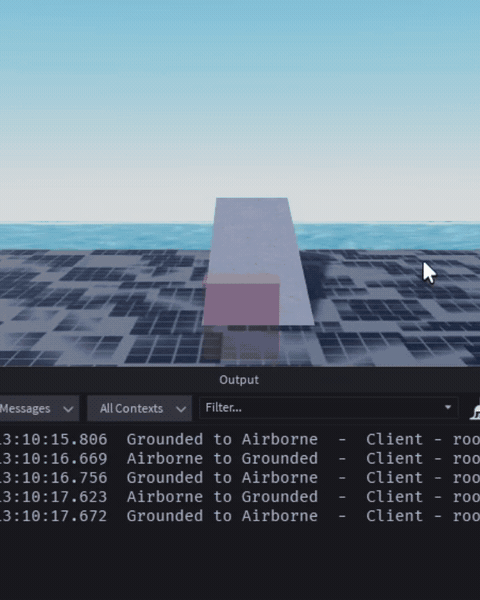

# Noid

Humanoid styled state machine for custom Roblox character controllers.

It does not move anything and does not cast anything. Physics, raycasting and replication stay with you.



## Install

### Wally

Add it to your `wally.toml`, then run `wally install`.

```toml
[dependencies]
Noid = "superdupernairobi/noid@0.1.0"
```

### Studio
Download `Noid.rbxm` from the [latest release](https://github.com/superdupernairobi/Noid/releases), drag it into `ReplicatedStorage` and require it from wherever you put it.

## Use

```luau
local Noid = require(game:GetService("ReplicatedStorage").Packages.Noid)

local machine = Noid.Machine.new("Idle", "client")

local desired = Noid.Conditions.resolve({ grounded = true })
if desired then
    machine:Change({ state = desired, source = "sensor" })
end

machine:Changed():Connect(function(old, new)
    print(old, "to", new)
end)
```